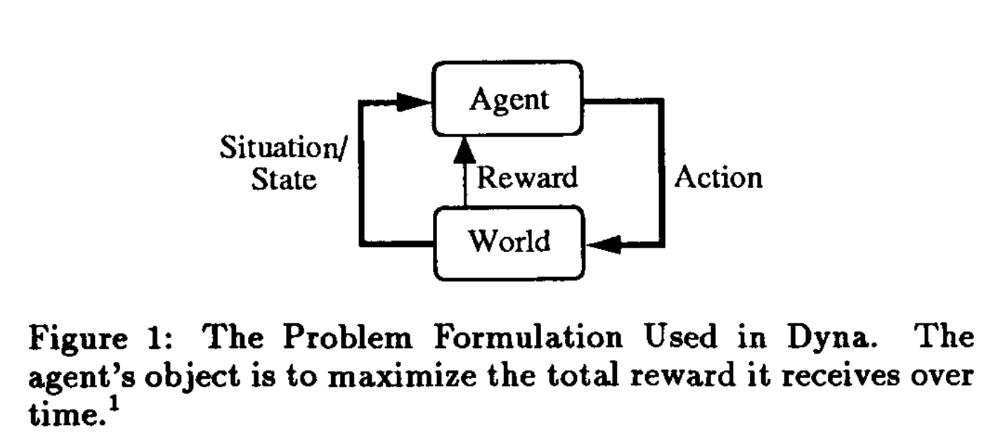
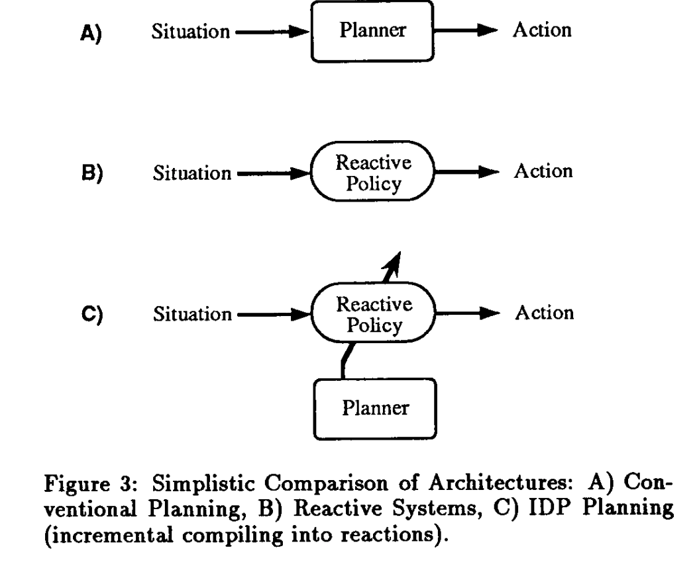

### One-line takeaway

Dyna is an architecture in which an RL agent also learns a model of the world and learns from imagined experience generated by that model, using the same RL update it applies to real experience.
Planning becomes the same operation as learning, just with a different data source.

### The problem formulation is plain RL



Figure 1 is the standard agent and environment loop, and Sutton says himself that this formulation had been used in RL for years.
The novelty of the paper is not in Figure 1 but in the solution architecture of Figure 2.
In 1991 this framing was still unfamiliar to the AI planning community, which thought in terms of explicit goals, logical operators and search trees.
Part of the paper's purpose is to persuade planners to adopt reward maximization, and it feels basic today because that argument won.
The word "object" in the caption means objective, and footnote 1 refers to discounting, which later appears as γ.

### What Dyna actually is

Dyna is not a new RL algorithm and not a new model learning method.
It is the wiring that connects four processes, which conceptually run in parallel.
Acting picks actions instantly from the current policy.
Direct RL improves the policy from real experience.
Model learning updates the model so it predicts the next state and reward.
Planning samples state and action pairs, asks the model what would happen, and applies RL to the simulated outcome.

In the generic loop of Figure 2, Steps 1 to 3 form a standard model-free agent, Step 4 learns the model, and Step 5 repeats K imagined updates.
In short, Dyna puts a learned copy of the World box inside the Agent box.

Building a concrete agent means choosing three components, namely the model, the search control that picks imagined starting states and actions, and the RL method.
A table model, random previously visited states, and Q-learning give Dyna-Q, the textbook version.
Real and simulated experience both use the same target.

```
Q(x, a) ← r + γ max_b Q(y, b)
```

### IDP planning

IDP stands for Incremental Dynamic Programming, a term Sutton borrows from Watkins (1989) for Steps 5.1 to 5.3.
Classical dynamic programming sweeps the whole state space and needs a complete and correct model.
IDP does one small update at a time on a sampled state and action pair and works with a model that is still being learned.
The term did not stick, and today this is simply called the planning step of Dyna-Q or model-based planning.

### Comparing architectures



The key difference among the three is where the planner sits.

In A, conventional planning, the planner is on the path between situation and action.
It is flexible but slow, because the agent is frozen while it searches.

In B, a reactive system, there is no planner and a policy maps situations directly to actions.
It is instant but someone has to design or learn the policy, and it cannot reason about anything new.

In C, IDP planning, the policy stays on the action path so responses are as fast as in B.
The planner sits off the path and keeps improving the policy, and the diagonal arrow is old engineering notation for an adjustable component.
"Incremental compiling into reactions" means planning results are cached into the policy instead of being used once and discarded, and even a little planning helps immediately.

A human analogy is learning to drive, where deliberate thinking (A) gradually turns into expert reflexes (B) through mental rehearsal over time (C).
Footnote 2 admits that Figure 2 runs planning after each action for teaching simplicity, while the true architecture runs acting and planning simultaneously.

### Planner versus reactive policy

A reactive policy stores answers, so choosing an action is a lookup or one forward pass.
A planner stores knowledge about how the world works and derives an action at decision time.
It is like memorized directions versus a map, fast and rigid versus slow and flexible.
Updating the model or reward changes what a planner computes right away, a point Sutton makes in Section 4.5 on taskability.
In modern terms a policy is amortized planning, where the cost of planning is paid during training and cached.

The word "reactive" is redundant today, since any policy π(a|s) is already a state to action mapping.
Sutton uses it to contrast with the planner's notion of a plan, an open-loop action sequence that breaks when something unexpected happens.
It also ties into the reactive systems debate of the time (Brooks, Agre and Chapman, Schoppers).
The distinction still matters for policies with memory or policies that search at every step, such as MuZero's MCTS, which is really A in Sutton's terms.

### Using a world model does not mean A

Both A and C use a world model, and only B is model-free.
The useful axis is whether the model is used at decision time or at training time.
Dyna and Dreamer use a world model yet act reactively, so they are C.
PlaNet and TD-MPC search through the model at every step, so they are A.
AlphaZero and MuZero do both, searching at decision time and distilling the search into a policy network.

### Dyna is fully online

There is no separate training phase, and every real step updates the policy, updates the model, and runs K planning updates.
Section 2 requires learning methods that operate incrementally, processing examples one by one rather than in multiple passes over a saved dataset.
So "background" in Figure 3C means concurrent, not beforehand.
Dyna-Q is online but off-policy, since Q-learning can learn from any experience, including imagined experience from arbitrary states.

### Historical context

The idea of planning as trying things in your head goes back to Craik (1943) and Dennett (1978), and Sutton and Barto (1981) had an earlier model-learning network.
Werbos (1987) and Whitehead (1989) also proposed related ideas, and Schmidhuber (1990) independently learned world models for control.
The original Dyna paper is Sutton (1990) at ICML, and this SIGART piece is a short overview.
Dyna came after Sutton's work on actor-critic (1983 and 1984) and TD learning (1988), as the step of fitting a learned model into the same framework.

### Open problems that became research fields

Section 4 reads almost like a roadmap of later RL research.
Reliance on supervised learning became function approximation and deep RL.
Hierarchical planning became options and hierarchical RL.
Ambiguous and hidden state became POMDPs and latent state models such as Dreamer.
Ensuring variety in behavior became exploration and intrinsic motivation.
Taskability became goal-conditioned RL.
Incorporation of prior knowledge became learning from demonstration.

### Connection to modern world models

Ha and Schmidhuber's World Models (2018) described training an agent inside its own dream, and Dreamer continues that line, both direct descendants of Dyna's Step 5.
Xing et al.'s Critiques of World Models (2025) and PAN list using the world model to simulate experience for RL training as a design principle, which is Figure 3C at scale.
They also use the world model for thought experiments at decision time, which brings back A.
So Xing's agent model is best read as Dyna's C plus a return of A, similar to the System 1 and System 2 distinction.
Sutton chose C because decision-time planning was too slow in 1991, while the modern view is that an agent needs both and must decide when to react and when to stop and think.
